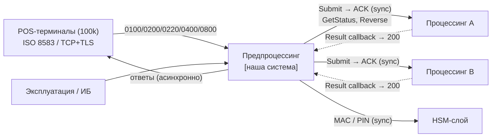
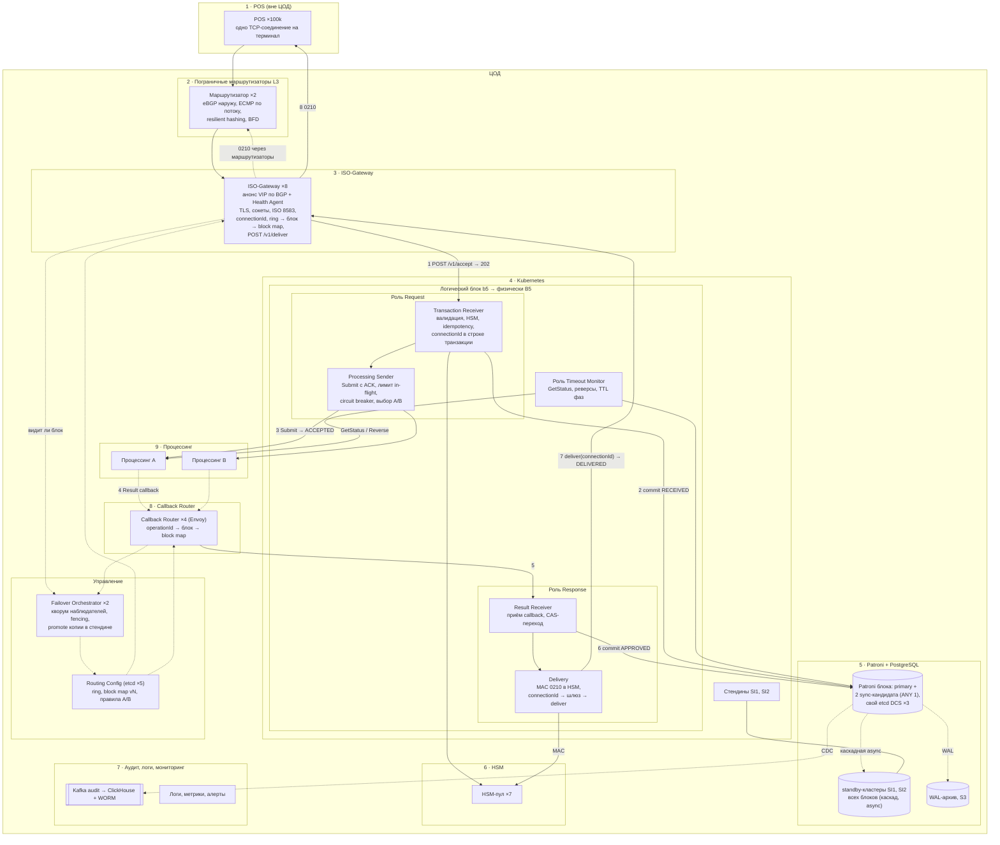
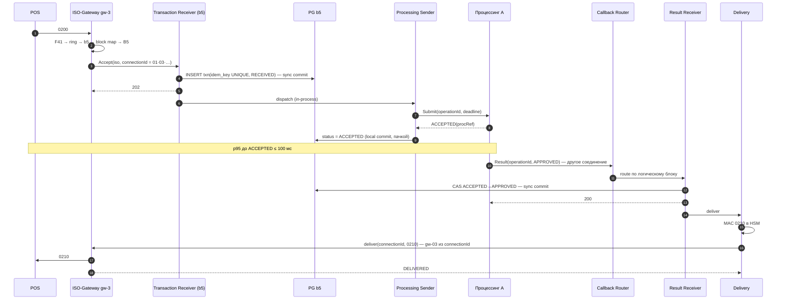
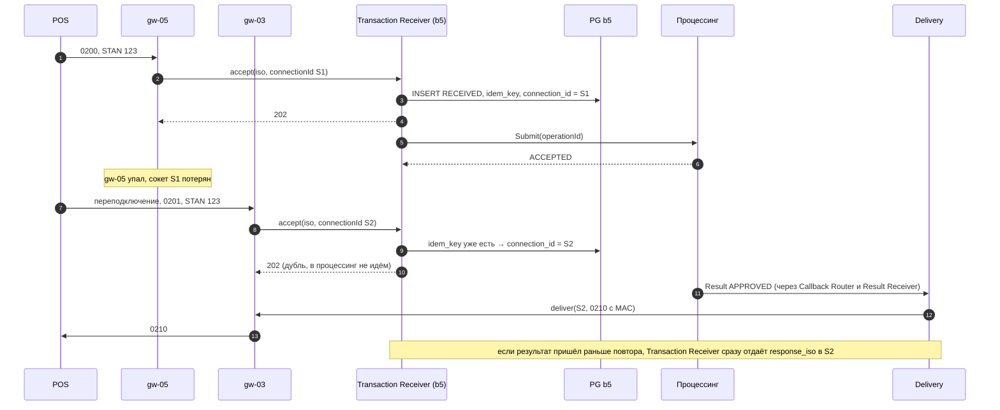
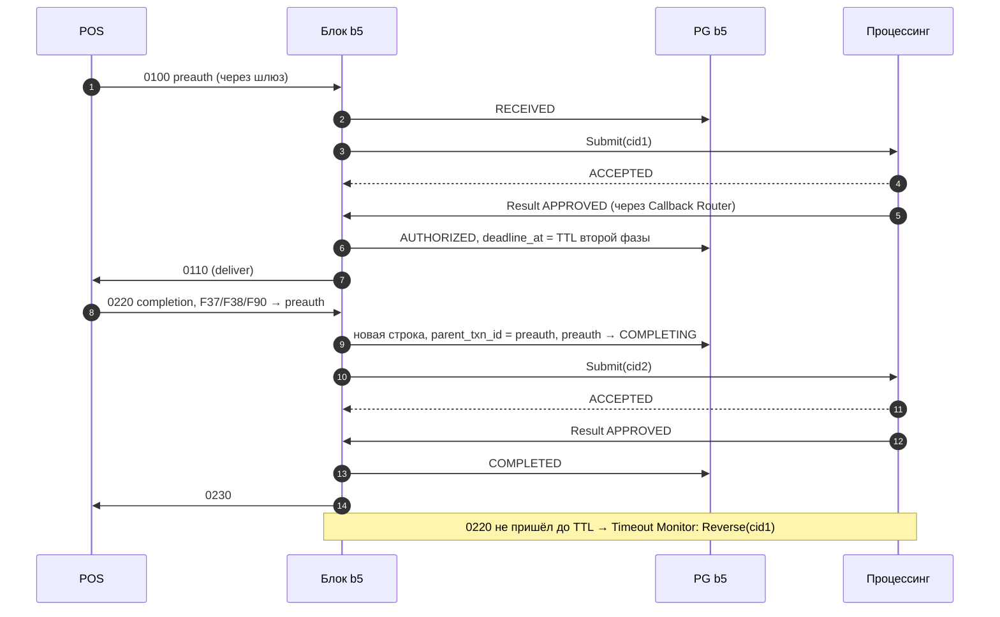
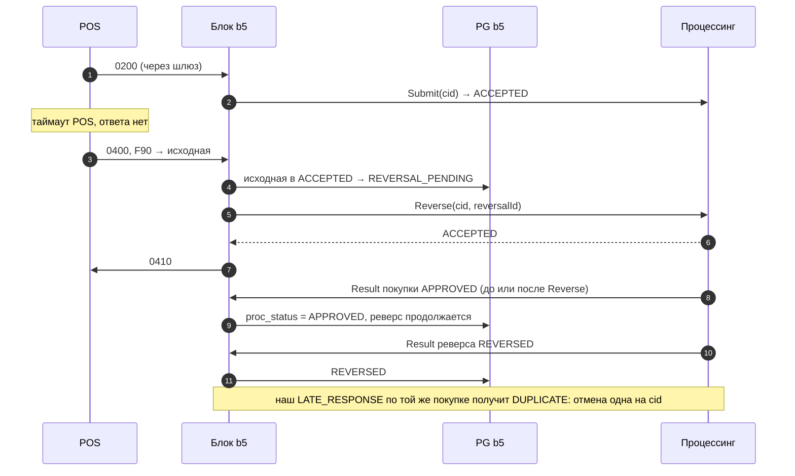
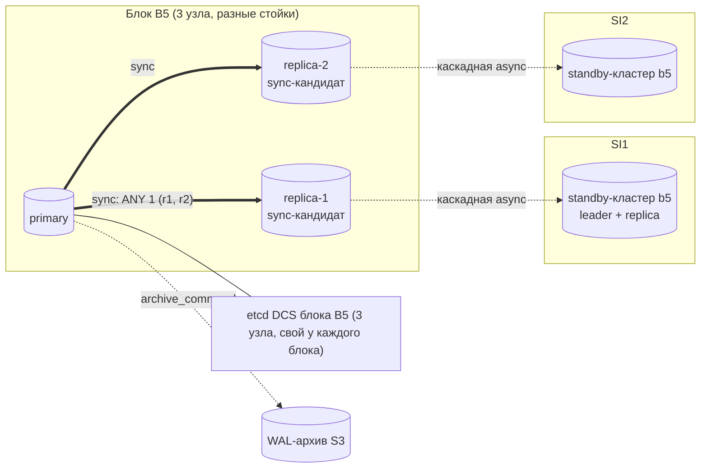
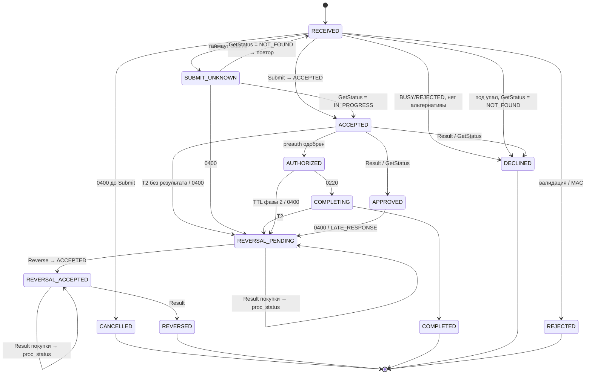

# Предпроцессинг транзакций POS → Processing: архитектура (ред. 5)

Документ закрывает четыре блока защиты: **(1) архитектурная схема, (2) хранение данных,
(3) масштабируемость и производительность, (4) отказоустойчивость и надёжность.**
Источник условий — `system_design_task`, шаблон — `system_design_image.png`. Метод — скил
`system-design`: уточнить → оценить → спроектировать → взвесить → проверить отказы.

**Что изменено во второй редакции и почему**

| Было | Проблема | Стало |
|---|---|---|
| Kafka между предпроцессингом и процессингом | Запись в топик не значит, что процессинг принял запрос. Нет обратного давления: при отсутствии ответа остаётся только слать ещё, рискуя задавить процессинг | **Контракт с подтверждением:** синхронный `Submit` → `ACCEPTED/BUSY/REJECTED`, результат приходит callback'ом с подтверждением, `GetStatus` для выяснения статуса, лимит одновременных запросов (in-flight) |
| Ответ шлюзу через Kafka-топик на шлюз | Та же проблема: неизвестно, дошёл ли ответ до POS. При падении шлюза ответы остаются без получателя | Прямой вызов `Deliver` в шлюз, который держит сокет, с ответом `DELIVERED/NO_CONNECTION`. Номер шлюза зашит в `connectionId`, реестра соединений нет |
| «PG primary + реплика» | Не описано, что происходит при потере реплики, нет fencing и бэкапов | Patroni из 3 узлов с **кворумной синхронной репликацией**, каскадные реплики в стендины, WAL-архив |
| Стендин в одну строку | Нет процедуры, неясно, куда пойдут callback'и процессинга и что делать с транзакциями «в полёте» | Логический блок ≠ физическое место. Пошаговый плановый и аварийный runbook, fencing, сверка потерянного хвоста |
| `operationId = b5:txnId` (случайный) | После аварийного failover стендин не может спросить процессинг о транзакции, которой у него нет | `operationId` выводится детерминированно из ключа идемпотентности |

**Что изменено в третьей редакции**

| Было | Проблема | Стало |
|---|---|---|
| LB, ISO-Gateway, Callback Router и control plane в одном «Edge» | Неясно, что за что отвечает и в какую сторону идёт трафик | 9 слоёв (§1.3): пограничные маршрутизаторы, ISO-Gateway и Callback Router — отдельные слои, control plane — сквозная полоса «Управление». Слоя L4 LB нет (§1.8) |
| Мониторинга и логов нет на схеме | Failover и Timeout Monitor опираются на health-сигналы, которых нет | Слой 7: аудит, логи, метрики и алерты; health-сигналы идут в Failover Orchestrator |
| gRPC между сервисами и в контракте | Команде привычнее HTTPS; критичных для нас свойств gRPC (стриминг) не используем | HTTPS: HTTP/2, mTLS, keep-alive, JSON; байты ISO 8583 — base64 |
| Один etcd на маршрутизацию и DCS Patroni | Общий домен отказа для всех блоков, нарушен bulkhead | Свой etcd ×3 под Patroni в каждом блоке, отдельный etcd ×5 для маршрутизации |
| Failover Orchestrator в одном экземпляре | Единая точка отказа для failover | 2 экземпляра, лидер по lease в etcd |
| Сокеты на LB, релиз шлюза, reconnect-шторм не описаны | Непонятно, что рвётся при отказе LB или шлюза | §1.8: ECMP с маршрутизаторов сразу на шлюзы, анонс VIP шлюзом по BGP под контролем Health Agent, resilient hashing; переподключение — штатный сценарий, запас N+2 |
| Реестр соединений в блоке (`RegisterSession`) | Лишний вызов на каждое подключение и таблица | Самомаршрутизируемый `connectionId` с номером шлюза; новое соединение получает ответ только на повтор (§1.5) |
| Реверс описан только для T2 и `LATE_RESPONSE` | Не разобраны 0400 Реверс на однофазную, отклонённую и ещё не принятую операцию | §1.9 и обязательство процессинга по порядку операций (§1.4) |

**Что изменено в четвёртой редакции**

| Было | Проблема | Стало |
|---|---|---|
| Хеш `operationId` зависел от блока | После переезда терминала в другой блок (рост ring, миграция с монолита) 0400 Реверс на одобренную покупку не находит исходную, процессинг ставит запрет — деньги не возвращаются | Хеш только от `idem_key`, префикс — блок происхождения; сообщения по ненайденным операциям пересылаются прежнему владельцу (§1.4, §3.3, §7) |
| Шлюз мог ответить `91 HOLD` по таймауту `accept` | Терминал получает два ответа на один STAN: `91 HOLD` и одобрение | Шлюз отвечает `91 HOLD` сам только когда запрос точно не принят (§1.5) |
| Отмена идемпотентна по `reversalId` | `LATE_RESPONSE` и 0400 Реверс терминала — две отмены одной покупки | Одна действующая отмена на `operationId` исходной (§1.4) |
| CDC с логического слота primary | Слот теряется при failover → дыра в аудите | Постоянный слот Patroni + сверка после failover (§2.2) |
| Health Agent проверял связь с блоками | Общий сбой снимает с анонса все шлюзы сразу | Анонс зависит только от локального здоровья шлюза (§1.8) |
| `idem_key` содержал F7 | F7 меняется на повторе → повтор становится второй операцией | `TID · STAN · F13 · класс MTI` (§2.3) |
| HSM только на входе, пул ≥3 без расчёта | Подпись MAC ответа не учтена, мощности может не хватить | MAC 0210 Ответ на покупку в Delivery, расчёт пула — 6 HSM (§3.1) |
| 5 блоков по 4 000 TPS | В burst с перекосом ring блок упирается в потолок sync-коммитов | 6 блоков по ~3 330 TPS (§3.1) |
| HOLD в Callback Router, сайзинг стендина, preauth старше 3 дней, callback во время реверса, 08xx, ссылка на пустой drawio, обратный путь через экран | Мелкие пробелы | §4.1, §3.1, §2.3, §2.4, §1.8, §1.3, §6 |
| Нет раздела безопасности, диаграмм retry, двухфазной операции и реверса, плана реализации | Не закрыты артефакты 8, 4 и 10 | §8, §1.10, §9 |

**Что изменено в пятой редакции**

| Было | Проблема | Стало |
|---|---|---|
| `idem_key = TID · STAN · F13 · класс MTI` | STAN из 6 цифр идёт по кругу и сбрасывается при перепрошивке: в пределах суток два разных платежа получают один ключ, и второй получает чужой сохранённый ответ. F90 в 0400 Реверс несёт F7, а не F13, поэтому исходную приходилось искать перебором дат | `TID · STAN · F7 · класс MTI`. Прошивка наша: F7 — время первой отправки и в повторе не меняется. F90 даёт ключ исходной точно. Отпечаток содержимого ловит подмену — отказ `94` (§2.3, §1.9) |
| Timeout Monitor «отправляет строку `RECEIVED`» после падения пода | Отправлять нечего: тело запроса в БД не хранится, и хранить его нельзя — в нём PIN-блок и дорожка карты (PCI DSS) | Из БД запрос не переотправляется. `GetStatus` → найден: ждём результат; не найден: запрет через `Reverse` и отказ `91 LATE` за 2–3 с (§1.7) |
| Эхо 0800 без периода и без расчёта нагрузки | Неизвестно, сколько сообщений и кто их обрабатывает; sign-on при шторме переподключений шёл в HSM | Эхо раз в 60 с простоя, до 1 700/с, отвечает шлюз. Sign-on и эхо без MAC — шторм не доходит до HSM (§1.8, §3.1) |
| Failover Orchestrator получал health из мониторинга | Отказ мониторинга запрещал аварийный перевод блока; §4.1 и §4.3 противоречили друг другу | Оркестратор опрашивает наблюдателей сам. Мониторинг — только для людей (§4.1, §4.3) |
| Все блоки и стендины — «в Kubernetes» | Общий Ingress и общие узлы связывают блоки: сбой одного отнимает ресурсы у остальных | У блока свои узлы, свой ingress-шард, квоты и сетевые политики; стендины — в отдельном кластере (§1.8, §6) |
| HSM ×6, запас 5 + 1; общий пул | Отказ во время обслуживания другого HSM оставляет без запаса; общий пул связывает блоки | 7 HSM (5 + 2), лимит запросов к HSM на блок, активные проверки (§3.1, [`layers.md`](layers.md)) |
| Callback Router брал блок из тела запроса | Envoy пришлось бы разбирать JSON | Блок в пути: `POST /v1/blocks/{block}/result` (§1.4) |
| Блок проверял версию block map и кольцо по подписке на etcd | Бизнес-слой зависел от слоя управления | Второго владельца исключает БД: прежнее место блока только читает. Чужой терминал после смены кольца обрабатывается пересылкой прежнему владельцу (§1.4, §4.1) |
| `DELIVERED` считался доставкой | Запись в сокет не доказывает получение | Явное правило: недополучивший терминал шлёт 0400 Реверс; `TCP_USER_TIMEOUT` на сокетах (§1.5) |
| Окно времени ±5 минут для всех сообщений | Законные поздние 0220 Завершение и 0400 Реверс отклонялись бы | Окно только для 0100 Предавторизация и 0200 Покупка; часы терминала подводятся по 0810 Ответ на сетевой запрос (§8) |
| Поведение терминала — в вопросах заказчику | Прошивку выпускаем мы, это наши решения | Правила прошивки и поля сообщений — [`iso8583.md`](iso8583.md); вопросы 3, 7, 10–13 закрыты (§6) |
| В бюджете доступности нет отказов primary и шлюзов | Бюджет неполный | Расчёт с долей парка (§4.2) |

**Переименованы сервисы блока** (имя теперь говорит, что сервис делает):

| Было | Стало | Роль |
|---|---|---|
| Acceptance | **Transaction Receiver** | Принимает сообщение терминала, проверяет, записывает |
| Dispatcher | **Processing Sender** | Отправляет операцию в процессинг |
| Result API | **Result Receiver** | Принимает результат процессинга |
| Deadline Worker | **Timeout Monitor** | Следит за сроками, выясняет статус, запускает отмены |
| Delivery | Delivery (без изменений) | Доставляет ответ терминалу |

**Упаковка: один образ, три роли запуска.** Пять частей блока — это модули одного
приложения (один репозиторий, один образ `block-app`, один конвейер сборки). Запускается оно
в трёх ролях, у каждой свой Deployment:

| Роль | Модули | Экземпляров на блок | Кто её вызывает |
|---|---|---|---|
| **Request** (`block-request`) — путь запроса | Transaction Receiver + Processing Sender | 4–8, по нагрузке | ISO-Gateway |
| **Response** (`block-response`) — путь ответа | Result Receiver + Delivery | 3–6, по нагрузке | Callback Router |
| **Timeout Monitor** (`block-timeout-monitor`) | Timeout Monitor | 2 | Никто: работает по времени |

Внутри роли модули вызывают друг друга в памяти, без сети. Модуль Delivery как библиотека
есть во всех трёх ролях: роль Request отдаёт им сохранённый ответ на повтор, Timeout Monitor
— отказ `91 LATE`.

**Переименован идентификатор соединения:** `sessionId` → `connectionId` (столбец
`connection_id`, ответ шлюза `NO_CONNECTION`, заголовок `X-Connection-Id`). Он обозначает
TCP-соединение терминала на конкретном шлюзе, а не сессию: состояния по нему нет.

**Сопутствующие документы:** [`business-scenarios.md`](business-scenarios.md) — сценарии по
шагам с полями ISO 8583, [`preprocessing-architecture-notes.md`](preprocessing-architecture-notes.md)
— пояснения к схеме, [`task-answers.md`](task-answers.md) — ответы на вопросы ТЗ,
[`layers.md`](layers.md) — описание слоёв, [`iso8583.md`](iso8583.md) — протокол терминала,
[`diagrams/full-architecture.mmd`](diagrams/full-architecture.mmd) — общая схема (чистый Mermaid),
[`diagrams/`](diagrams) — схемы по слоям.

---

## 0. Рамка

**Из ТЗ:** 5 000–20 000 TPS; 100 000 терминалов; p95 < 100–200 мс до отправки в процессинг;
SLA 99.99 %; active-active; AP между блоками, строгая консистентность внутри блока;
POS повторяет запросы; ответ процессинга асинхронный и по другому соединению;
POS ↔ мы — TCP+TLS, ISO 8583; consistent hashing по `terminalId`; HSM — отдельный слой;
стендин-блоки: «eventual consistency + sync».

**Допущения (подтвердить на защите):**

| # | Допущение |
|---|---|
| A1 | 20 000 TPS — пик финансовых сообщений, burst ×2 до 60 с; средняя нагрузка = 25 % пика |
| A2 | Таймаут POS = 30 с от первой отправки, повторы входят в него (параметр TMS, [`iso8583.md`](iso8583.md) §7.2); окно реверса ≤ 24 ч |
| A3 | Процессинг реализует наш контракт (§1.4) сам или через тонкий адаптер на своей стороне |
| A4 | Медиана времени до результата у процессинга ≈ 1 с, p99 ≈ 5 с |
| A5 | Один HSM выполняет ~10k операций MAC в секунду; PIN есть у 30 % операций |
| A6 | Прошивка наша: повтор побайтно равен оригиналу, кроме 4-й цифры MTI и MAC; F7 — время первой отправки; в 0400 Реверс и 0220 Завершение есть F90 с исходными MTI, STAN и F7 |

---

## 1. Архитектурная схема

### 1.1 Идея

- **Терминал закреплён за логическим блоком** (consistent hashing по `terminalId`, поле 41).
  Логический блок `b5` в каждый момент обслуживается **одним физическим местом**: основным
  блоком B5 или стендином. Это соответствие хранит control plane, раздаёт его по версиям,
  и только оно меняется при переводе в стендин.
- **Внутри блока всё синхронно и с подтверждениями.** Каждый шаг, после которого мы
  «что-то знаем», подтверждён: БД — коммитом, процессинг — `ACCEPTED`, результат —
  нашим `200` на callback, доставка в POS — `DELIVERED` от шлюза.
- **Kafka уходит из критического пути.** Она остаётся только для потока аудита и аналитики,
  где буферизация полезна, а подтверждение получателя не нужно.
- **Система разложена по слоям** (§1.3). У каждого слоя одна роль и свой домен отказа:
  вход POS (слои 2–3) и вход процессинга (слой 8) разделены, чтобы шторм callback'ов не
  задевал сокеты терминалов.

### 1.2 C4 — контекст

### 1.3 C4 — контейнеры по слоям

Слой 1 находится вне ЦОД, слои 2–9 — в одном ЦОД. «Управление» — сквозная полоса вне data path.

Полная схема: [`diagrams/full-architecture.mmd`](diagrams/full-architecture.mmd) — чистый Mermaid, вставляется в mermaid.live целиком; пояснения — в [`preprocessing-architecture-notes.md`](preprocessing-architecture-notes.md).

### 1.4 Контракт с процессингом (главное изменение)

Процессинг для нас чёрный ящик, но **интерфейс задаём мы**, и процессинг его реализует (подтверждено заказчиком). Транспорт — HTTPS
(HTTP/2, mTLS, keep-alive), тело JSON, отдельный пул соединений на каждый блок и каждый процессинг.
Методы — это `POST /v1/submit`, `POST /v1/blocks/{block}/result` (на нашей стороне, через
Callback Router; `{block}` — префикс `operationId`, чтобы Router выбирал блок по пути, не
разбирая тело),
`POST /v1/status`, `POST /v1/reverse`.

**Почему HTTPS, а не gRPC.** Стриминг нам не нужен: каждый вызов — один запрос и один ответ.
HTTP/2 даёт то же мультиплексирование на одном соединении, а разница в сериализации JSON и
protobuf при ~3 мс на вызов не влияет на p95. HTTPS команде знаком, его проще отлаживать
(curl, логи прокси) и защищать. Схема запросов и ответов фиксируется в OpenAPI, которая
и есть контракт с процессингом.

Короткие имена `Submit`, `Result`, `GetStatus`, `Reverse` дальше используются как названия
операций. Тела запросов, коды HTTP и примеры JSON —
[`my-questions-answers.md`](my-questions-answers.md), ответ 2.

| Метод | Направление | Синхронный ответ | Смысл |
|---|---|---|---|
| `POST /v1/submit` — Submit `{operationId, operation, deadline, …}` | мы → процессинг | `ACCEPTED{procRef}` — запрос **надёжно сохранён** у процессинга и будет обработан; `DUPLICATE{status}` — такой `operationId` уже есть; `BUSY{retryAfter}` — не принят, перегрузка; `REJECTED{code}` — не принят, ошибка формата или бизнес-правила | Мы точно знаем, принят запрос или нет |
| `POST /v1/blocks/{block}/result` — Result `{operationId, seq, status, authCode, …}` | процессинг → мы (callback, **другое соединение**) | `200` после нашего коммита | Процессинг повторяет callback с backoff, пока не получит `200` (at-least-once); мы дедуплицируем по `operationId + seq` |
| `POST /v1/status` — GetStatus `{operationIds: […]}` | мы → процессинг | `NOT_FOUND / IN_PROGRESS / APPROVED / DECLINED / REVERSED` по каждому | Выяснение статуса, пачками до 100 id |
| `POST /v1/reverse` — Reverse `{operationId, reversalId, reason}` | мы → процессинг | `ACCEPTED / DUPLICATE{status} / NOT_FOUND` | **Одна действующая отмена на `operationId` исходной:** повторный `Reverse` с любым `reversalId` получает `DUPLICATE` со статусом первой отмены. `reversalId` — для журнала |

`operationId = <блок_происхождения>.<base32(SHA-256(idem_key))[:26]>`, например `b5.K3F…`. Префикс — логический блок, где операция появилась. Он нужен Callback Router: по нему callback попадает в текущее место блока без запроса в БД. Хеш от блока не зависит. Id **детерминирован**:
повтор того же запроса из любого места, включая стендин после аварии, даёт тот же id,
и процессинг его дедуплицирует.

**Если терминал сменил блок.** Терминал переходит в другой блок при добавлении блока в ring
(§3.3) и при миграции с монолита (§7). Его закрытые, но ещё отменяемые операции остаются у
прежнего владельца. Поэтому etcd хранит историю ring и переводов. В течение окна реверса и
срока второй фазы **шлюз** отправляет сообщение, которое ссылается на прежнюю операцию
(0400 Реверс, 0220 Завершение, повтор), прежнему владельцу, если время исходной (F90, для повтора — F7) раньше
момента перевода терминала. Прежний владелец обрабатывает его как своё и отвечает через
`deliver` по `connectionId` из запроса. Если там операции нет (`404 ORIGINAL_NOT_FOUND`),
шлюз повторяет `accept` текущему владельцу с `X-Lookup-Done`, и работает правило «не найдена»
из §1.9. Приложения блоков историю кольца не читают: маршрутизация — только на слое шлюзов.

**Когда появляется `operationId` и что он идентифицирует.** Его вычисляет Transaction Receiver сразу
после разбора сообщения: `idem_key` → `operationId`. Он записывается в той же транзакции, что
и `RECEIVED`, до любого обращения к процессингу. `operationId` идентифицирует **одно
финансовое сообщение к процессингу** (один `Submit`) со всеми его повторами: повтор 0201 даёт тот
же `idem_key`, а значит, тот же `operationId`. Всю бизнес-цепочку он **не** объединяет. У
preauth (0100 Предавторизация) и completion (0220 Завершение) разные STAN, поэтому разные `operationId`. Реверс
ссылается на `operationId` исходной операции и имеет свой `reversalId`. Звенья одной цепочки
связаны полем `parent_txn_id`.

| Идентификатор | Кто создаёт | Что идентифицирует | Живёт |
|---|---|---|---|
| `connectionId` | ISO-Gateway при приёме соединения | Одно TCP-соединение терминала | Пока жив сокет |
| `idem_key` | Transaction Receiver, из полей ISO: `TID · STAN · F7 · класс MTI` | Одно сообщение терминала со всеми его повторами | Вместе со строкой транзакции |
| `operationId` | Transaction Receiver, из `idem_key` | Ту же операцию в процессинге; префикс — блок происхождения, для Callback Router | В нашей БД и у процессинга |
| `reversalId` | Блок, из `idem_key` сообщения 0400 Реверс или из причины автореверса | Одну отмену | Как `operationId` |
| `parent_txn_id` | Блок | Связь второй фазы и реверса с исходной операцией | В нашей БД |

**Порядок операций по одному `operationId` (обязательство процессинга).** Процессинг
обрабатывает операции с одним `operationId` последовательно. `Reverse`, пришедший раньше
`Submit` или во время его обработки, отменяет его. `Reverse` на неизвестный id отвечает
`NOT_FOUND` и оставляет запрет («надгробие»): поздний `Submit` с этим id получает `REJECTED`.
Без этого правила реверс на операцию в `SUBMIT_UNKNOWN` или на потерянную при failover
небезопасен (§1.9).

**Что делаем по каждому исходу `Submit`**

| Исход | Что знаем | Действие |
|---|---|---|
| `ACCEPTED` | Процессинг принял запрос | Состояние `ACCEPTED`, ждём callback до `deadline`. **Повторно не отправляем никогда** |
| `DUPLICATE` | Уже принят раньше | Берём статус из ответа, ждём callback |
| `BUSY` | Не принят | Не повторяем сразу: снижаем лимит in-flight (AIMD). Если правила разрешают процессинг B — отправляем туда, иначе контролируемый отказ POS (`91 BUSY`) |
| `REJECTED` | Не принят, повтор бессмысленен | Отказ POS с маппингом кода |
| Таймаут или обрыв без ответа | **Не знаем** | Состояние `SUBMIT_UNKNOWN` → через 1 с `GetStatus`. `NOT_FOUND` → повтор `Submit` с тем же `operationId` (безопасно). Найден → принимаем его статус. **В другой процессинг такой запрос не отправляем** |

**Как не задудосить процессинг**

- **Лимит in-flight на пару (блок, процессинг)** — адаптивный (gradient/AIMD по латентности
  ACK), с жёстким потолком из соглашения с процессингом. Когда лимит исчерпан, новые запросы
  ждут свободный слот до 50 мс, затем получают отказ `91 BUSY`. Очереди перед процессингом нет.
- **Circuit breaker по ACK:** открывается при таймаутах или `BUSY` > 20 % на окне 5 с.
  В открытом состоянии `Submit` не вызывается, `GetStatus` и `Reverse` тоже ставятся на паузу.
  В half-open пропускаем 1–2 % трафика.
- **Бюджет вспомогательного трафика:** `GetStatus` и `Reverse` вместе не больше 5 % от
  лимита, пачками. Восстановившийся процессинг получает отложенные реверсы постепенно,
  через token bucket, а не лавиной.
- **Повторы `Submit`** допустимы только для `SUBMIT_UNKNOWN` после `NOT_FOUND` и только
  в пределах `deadline`.

**Если процессинг молчит после `ACCEPTED`**

1. `T1` (= p99 процессинга ≈ 5 с): один `GetStatus` в общей пачке.
2. `IN_PROGRESS` — ждём дальше; финальный статус — применяем его, как будто пришёл callback.
3. `T2` (= таймаут POS − 5 с ≈ 25 с): отказ POS `91 LATE`, состояние `REVERSAL_PENDING`, `Reverse`
   отправляется, когда breaker это разрешает. Деньги не зависают: реверс хранится в нашей БД
   и повторяется, пока процессинг не ответит `ACCEPTED`.
4. Процессинг целиком недоступен — breaker открыт, новые запросы получают быстрый отказ или
   уходят в процессинг B. Уже принятые (`ACCEPTED`) ждут восстановления, `GetStatus` и реверсы
   догоняются по бюджету.

### 1.5 Обратный путь в POS: самомаршрутизируемый `connectionId`

- **Один терминал держит одно активное TCP-соединение.** Когда шлюз принимает соединение, он
  создаёт `connectionId = версия(1) · gatewayId(2) · gatewayEpoch(4) · random(8)`, например
  `01·05·0037·8F2A91C7B4D6`. `gatewayEpoch` — время старта процесса шлюза: после перезапуска
  старые `connectionId` этого шлюза уже не совпадут ни с одним живым соединением. Состояние соединений
  есть только в памяти шлюза: локальная таблица `connectionId → сокет`.
- Шлюз передаёт `connectionId` в каждом `POST /v1/accept`. Блок пишет его в строку транзакции
  (`transactions.connection_id`). **В процессинг `connectionId` не передаём:** процессинг знает
  только `operationId`, а путь до терминала — наша внутренняя забота.
- Когда результат готов, `Delivery` берёт `connection_id` из строки, извлекает `gatewayId` и
  вызывает `POST /v1/deliver {connectionId, iso}` у этого шлюза (HTTPS, mTLS). Адрес шлюза
  по номеру статичен (`gw-05.iso.internal`): шлюзы стоят вне OpenShift. **Реестра соединений нет:**
  ни глобального, ни в блоке.
- Ответ шлюза: `DELIVERED` (байты записаны в сокет) или `NO_CONNECTION` (терминал отключился,
  или шлюз перезапущен и epoch не совпал). Недоступный шлюз считаем `NO_CONNECTION`.
- **`DELIVERED` не доказывает, что терминал ответ получил:** байты могли остаться в буфере
  ядра. Подтверждения получения в ISO 8583 нет, и мы его не вводим. Разрыв закрывает
  терминал: не получив ответ за 30 с, он обязан прислать 0400 Реверс (F39 = `68` — ответ не получен) и повторять его до 0410 Ответ на реверс
  ([`iso8583.md`](iso8583.md) §7.2). На сокетах стоит `TCP_USER_TIMEOUT` 10 с, чтобы мёртвое
  соединение закрывалось быстро и следующий `deliver` получал `NO_CONNECTION`.
- Перед `deliver` Delivery подписывает 0210 Ответ на покупку MAC-ом в HSM на сессионном ключе терминала.
- **Отказ шлюза идёт без MAC:** у шлюза нет доступа к HSM. Прошивка принимает ответ без MAC,
  только если это отказ; одобрение без MAC отбрасывается ([`iso8583.md`](iso8583.md) §4.1).
- **Шлюз сам отвечает терминалу только отказом `91 HOLD` и только когда запрос точно не принят:**
  блок вернул ошибку до записи, соединение с блоком не установилось или сработал локальный
  лимит нагрузки. Если `accept` завершился таймаутом, шлюз молчит. Блок мог успеть записать
  `RECEIVED`, и тогда терминал получил бы два ответа на один STAN: `91 HOLD` и одобрение. Дальше
  работают повтор терминала и T2.
- **В новое соединение ответ сами не отправляем.** Если терминал переподключился и получил
  новый `connectionId`, ответ ждёт в БД. Терминал присылает повтор (0201/0221 Повтор завершения) уже из нового
  соединения. Блок находит транзакцию по `idem_key`, в процессинг не ходит и отдаёт сохранённый
  `response_iso` через `deliver` в `connectionId` повтора. Callback Router в этом не участвует:
  он только принимает callback'и процессинга. Сами в новое соединение не отправляем вот
  почему. `DELIVERED` не доказывает, что терминал ещё ждёт ответа. Если терминал уже признал
  операцию неуспешной, мы посчитали бы ответ доставленным и не запустили бы реверс
  `LATE_RESPONSE`, а у клиента осталось бы списание. Повтор от терминала — доказательство,
  что он ждёт.
- **POS уже не ждёт (сценарий 7):** ответ `APPROVED` доставляем только до срока ожидания POS.
  Если не доставили до этого срока, автоматически запускается реверс (`LATE_RESPONSE`), а не
  «повисший» платёж: касса считает операцию неуспешной, значит деньги клиента должны вернуться.
  Если 0400 Реверс от терминала придёт позже, он попадёт на уже идущий реверс по `parent_txn_id`.
  Повтор 0201 после запуска реверса получает отказ.

### 1.6 Отклонения от шаблона

| В шаблоне | У нас | Почему |
|---|---|---|
| API Gateway / LB | Слой 2 — маршрутизаторы L3 с ECMP, слой 3 — ISO-Gateway вне OpenShift, без отдельного LB | Долгоживущие TLS-сессии и разбор ISO 8583 до маршрутизации; шлюзы сами анонсируют VIP, маршрутизаторы раздают соединения хешем |
| Routing Layer в кластере | Блок выбирается в шлюзе, процессинг — в Processing Sender | Нужный блок надо знать до входа в блок |
| Idempotency Service + Store | Уникальный ключ в PG блока, в той же транзакции | Нет окна между «ключ записан» и «состояние записано» |
| Message Broker между нами и процессингом | Синхронный `Submit` с ACK + callback + `GetStatus` | Kafka не даёт ни подтверждения приёма, ни обратного давления |
| Async Response Handler читает брокер | Result Receiver принимает callback через Callback Router | Callback'и маршрутизируются по логическому блоку и переживают переезд в стендин |

### 1.7 Онлайн-транзакция

**Если под упал между коммитом `RECEIVED` и `Submit`.** Тело запроса в БД не хранится: в нём
PIN-блок и данные дорожки, которые по PCI DSS нельзя держать на диске. Поэтому из БД запрос
не переотправляется. Timeout Monitor через 2 с находит строку в `RECEIVED` без владельца и
делает `GetStatus`. Найдена — под успел отправить: состояние `ACCEPTED`, ждём результат. Не
найдена — `Reverse` ставит запрет на этот `operationId`, строка переходит в `DECLINED`,
терминал получает `91 LATE` и повторяет оплату с новым STAN. Повтор `Submit` для `SUBMIT_UNKNOWN`
делает тот же под из памяти; если упал и он, работает то же правило. Задеты только операции
упавшего пода «в полёте» — около 50 при 1 000 TPS на под.

### 1.8 Слои 2–3: путь пакета от POS до ISO-Gateway

**Схема.** Маршрутизаторы ×2 → ECMP → ISO-Gateway ×8. Слоя L4-балансировщиков нет: каждый
шлюз сам анонсирует VIP (/32) обоим маршрутизаторам по BGP (FRR на хосте). VIP висит на
loopback шлюза, поэтому шлюз — единственная конечная точка TCP и TLS. Ответ терминалу уходит
обычной маршрутизацией через маршрутизаторы и от ECMP не зависит.

**Кто что смотрит и что помнит**

| Слой | Устройство | Что смотрит | Что хранит в памяти | Роль в TCP |
|---|---|---|---|---|
| 2 | Пограничный маршрутизатор L3 ×2 | IP назначения; для ECMP — хеш 5-tuple | Таблицу маршрутов (RIB → FIB), ARP-соседей, группу ECMP с таблицей корзин resilient hashing. Соединений не помнит | Не участвует |
| 3 | ISO-Gateway ×8 | Содержимое: TLS, ISO 8583, F41 | Сокеты терминалов, TLS-сессии, таблицу `connectionId → сокет` | Конечная точка: подтверждения, повтор пакетов, окно, порядок |

**Маршрутизатор L3.** Протокол маршрутизации (BGP) заранее, в фоне, вычисляет пути. На каждый
пакет выполняется поиск в FIB и выбор следующего хопа. Наружу оба маршрутизатора по eBGP
анонсируют префикс с VIP. При отказе одного трафик идёт через второй (BFD < 1 с).
Межсетевой экран на этом рубеже хранит состояние сессий, поэтому пара экранов должна
синхронизировать свои таблицы.

**ECMP — это не round robin.** Хоп выбирается хешем 5-tuple **каждого пакета**. У пакетов
одного TCP-соединения хеш одинаковый, поэтому они всегда идут на один шлюз, хотя маршрутизатор
ничего не запоминает. Разные соединения расходятся статистически ровно.

**Требования к маршрутизаторам**

| Требование | Зачем |
|---|---|
| ECMP по потоку (5-tuple), не по пакету | Пакеты одного соединения идут на один шлюз |
| Одинаковые хеш-функция, seed и набор next-hop на обоих маршрутизаторах | Соединение, перешедшее на другой маршрутизатор, попадает на тот же шлюз |
| Resilient hashing (таблица корзин) | При уходе шлюза переезжают только его корзины, соединения исправных шлюзов не рвутся |
| BFD с каждым шлюзом | Падение хоста или сети снимается за доли секунды |

**Чего эти требования не гарантируют (проверено, принимаем осознанно)**
1. **Одинаковая конфигурация не означает одинаковую таблицу корзин.** Таблица resilient hashing
   зависит от истории: какие next-hop и в каком порядке уходили и возвращались на каждом
   маршрутизаторе. Соединение, которое после переключения у провайдера пришло через другой
   маршрутизатор, может попасть на чужой шлюз и оборваться. Это редкое событие; терминал
   переподключится.
2. **Resilient hashing защищает при уходе шлюза, а не при его возвращении.** Вернувшемуся шлюзу
   маршрутизатор отдаёт часть корзин, и соединения из этих корзин на других шлюзах рвутся.
   Поэтому шлюзы возвращаем в часы низкой нагрузки по одному, либо включаем режим
   «переназначать только простаивающие корзины» (idle timer), если оборудование его
   поддерживает (вопрос №8, §6).
3. **Вывод шлюза — всегда жёсткий разрыв его соединений.** После отзыва маршрута пакеты его
   соединений уходят на другие шлюзы и получают RST. Плавного drain при прямом ECMP нет.

**Health Agent → BGP.** Рядом со шлюзом работает агент. Каждую секунду он проверяет только
локальное: процесс жив, event loop отвечает, шлюз принимает соединения, не исчерпаны файловые
дескрипторы. Если проверка не прошла 3 раза подряд, агент отзывает анонс VIP. Недоступность
блоков, HSM или процессинга анонс **не** снимает. Это общая беда всех шлюзов, и отзыв на всех
сразу превратил бы её в полное отключение входа с переподключением 100k терминалов. В таком
случае шлюз отвечает `91 HOLD` и держит соединения. BFD ловит падение хоста и сети, агент — зависшее
приложение. BGP сам приложение не проверяет.

**Переподключение — штатный сценарий.** TCP-соединения между шлюзами не синхронизируем: это
дорого и добавляет точку отказа. Терминалы переподключаются, а слой шлюзов держит запас.

| Событие | Переподключений | Нагрузка на оставшиеся шлюзы |
|---|---|---|
| Упал 1 из 8 | ~12.5k | ~1.8k рукопожатий на шлюз; после — 14.3k соединений на шлюз |
| Упали 2 из 8 (расчётный запас N+2) | ~25k | ~4.2k рукопожатий на шлюз, если все сразу; после — 16.7k соединений на шлюз |
| Потолок шлюза | — | 20k рукопожатий/с, 20k соединений |

Терминалы должны переподключаться с задержкой и случайным разбросом (вопрос №10, §6).

**Релиз шлюза, по одному, в часы низкой нагрузки**
1. Агент отзывает анонс VIP: новые соединения идут на другие шлюзы.
2. Сразу после этого шлюз закрывает все сокеты. Ждать бессмысленно: пакеты его соединений
   уже идут на другие шлюзы. Если закрыть сокеты до отзыва, часть переподключений вернётся
   на этот же шлюз.
3. Ответы, которые не успели уйти, остаются в БД. Терминал заберёт их повтором, а если
   повтора не будет, сработает `LATE_RESPONSE` (§1.5).

**Два запроса одного терминала (auth → confirm).** Терминал привязан **к блоку, а не к шлюзу**:
блок вычисляется по `terminalId` через ring, и любой шлюз получит тот же блок. Состояние
первой фазы лежит в БД блока.

| Шаг | В том же соединении | Confirm в новом соединении |
|---|---|---|
| auth (0100 Предавторизация) | Маршрутизатор → хеш → gw-5 → ring → b5 | То же |
| confirm (0220 Завершение) | Тот же 5-tuple → тот же gw-5 и тот же сокет | Новый порт источника → новый 5-tuple → gw-3, новый `connectionId`; F41 → ring → тот же b5 |
| Связь фаз | b5 находит операцию auth в своей PG по исходным данным (F37/F38/F90) | То же |
| Ответ | `deliver` в `connectionId` auth → gw-5 | `deliver` в `connectionId` confirm → gw-3 |

**Шлюз → блок.** HTTPS через балансировщик блока. У каждого блока **свой** ingress-шард
(отдельный IngressController), свои рабочие узлы (taints), ResourceQuota и NetworkPolicy:
общий Ingress или общие узлы связали бы блоки и нарушили изоляцию. Приложения стендинов
работают в отдельном кластере, чтобы сбой кластера блока не задел его же резерв.
Привязки «сокет терминала → под» нет: ответ в терминал этим путём не идёт, а состояние лежит
в PG блока.

**Сетевые сообщения 08xx** (поля — [`iso8583.md`](iso8583.md) §4.2).
- **Эхо (F70 = 301):** терминал шлёт его после 60 с простоя (±10 %), ждёт ответ 10 с. Шлюз
  отвечает сам, не обращаясь в блок, и закрывает соединение, молчащее 150 с. Худший случай —
  100 000 / 60 ≈ 1 700 эхо/с на все шлюзы.
- **Sign-on (001):** идёт в блок терминала, проверяется по справочнику в памяти — без HSM и
  без записи в БД. Поэтому шторм переподключений не нагружает ни HSM, ни primary.
- **Смена ключей (101):** блок + HSM, с MAC. Новый сессионный ключ генерирует HSM, блок
  хранит его под LMK в справочнике ключей терминала. Примерно раз в сутки на терминал.

**Модель потоков шлюза.** Отдельный поток на терминал не заводим. Работает Netty: несколько
event loop обслуживают все сокеты через epoll.
- В event loop выполняются чтение, разбор ISO 8583 и асинхронный `POST /v1/accept`. Поток не
  ждёт ответа и сразу берётся за другие сокеты.
- Тяжёлое выносится в отдельный пул: TLS-рукопожатия при reconnect-шторме, журналирование.
- Сокет закреплён за своим event loop. Запись ответа из `/v1/deliver` передаётся в этот loop
  (`channel.eventLoop().execute`), поэтому блокировки на сокет не нужны.
- Backpressure: лимит запросов в полёте на шлюз и на терминал. При превышении терминал сразу
  получает `91 BUSY`, очередь в памяти не растёт.

**Почему без слоя L4.** Переподключения приняты как норма, поэтому главное преимущество L4 —
сохранить соединения при смене состава шлюзов — нам не обязательно. Без L4 меньше компонентов и
состояний. Слой L4 с одинаковым на всех узлах хешем Maglev понадобится, если у маршрутизаторов
нет resilient hashing или разрывы из п. 1–2 окажутся частыми. Тогда маршрутизаторам становится
безразлично, на какой L4 попал пакет.

### 1.9 Реверсы

- **Реверс бывает не только в двухфазных операциях.** 0400 Реверс приходит и на однофазную покупку
  (0200 Покупка), если терминал не получил ответ или кассир отменил операцию. Возврат (refund) — это
  не реверс, а новая финансовая операция, она идёт обычным путём.
- **Инициаторы:** терминал (0400 Реверс) и мы сами: T2 без результата, `LATE_RESPONSE`, истёк срок
  второй фазы (§1.4, §1.5).
- **Как найти исходную операцию.** F90 несёт исходные MTI, STAN и F7 — вместе с F41 это
  ровно `idem_key` исходной. Ищем по уникальному индексу, без перебора дат. Если исходная сделана до
  перевода терминала, шлюз уже отправил сообщение прежнему владельцу (§1.4). Не нашли нигде — `operationId` вычисляется из
  того же `idem_key`. Префикс — текущий логический блок: единственная оставшаяся причина —
  хвост, потерянный при аварийном переводе этого же блока.
- **Отмена одна на исходную операцию** (§1.4). Повторные 0400 и наш `LATE_RESPONSE` по той же
  покупке второй отмены не дают.

| Состояние исходной операции | Действие | Ответ POS (0410 Ответ на реверс) |
|---|---|---|
| Не найдена ни у нас, ни у прежнего владельца (не дошла до нас или потеряна при аварийном failover) | `Reverse` по вычисленному `operationId`. Процессинг вернёт `NOT_FOUND` и запретит этот id | После ответа на `Reverse` |
| `RECEIVED` (в процессинг ещё не отправлена) | `CANCELLED`, `Submit` не отправляем | Сразу |
| `SUBMIT_UNKNOWN`, `ACCEPTED` (ждём результат) | Сразу `Reverse`, исхода покупки не ждём | После `Reverse → ACCEPTED` |
| `DECLINED`, `REJECTED` | Финансово отменять нечего, в процессинг не ходим | Сразу |
| `APPROVED`, `AUTHORIZED`, `COMPLETED` | `Reverse` | После `Reverse → ACCEPTED` |
| Уже `REVERSAL_*` или `REVERSED` | Новый `Reverse` не создаём; процессинг и так ответил бы `DUPLICATE` | Сохранённый ответ |

**Почему не ждём исхода покупки.** Можно было бы держать реверс, пока не придёт результат
покупки, но это задерживает ответ POS и добавляет состояние «реверс ждёт». Вместо этого
порядок обеспечивает контракт (§1.4): процессинг сериализует операции по `operationId`.
`Reverse`, пришедший раньше или во время обработки `Submit`, отменяет его.

### 1.10 Ключевые потоки: повтор, двухфазная операция, реверс

Онлайн-транзакция — §1.7, деградация — таблица §4.3.

**Повтор после переподключения.** Терминал не получил ответ, переподключился к другому шлюзу
и прислал 0201 Повтор покупки.

**Двухфазная операция.** Preauth (0100 Предавторизация), затем completion (0220 Завершение) с новым STAN.

**Реверс, пока покупка ещё ждёт результат.** Терминал не дождался ответа и прислал 0400 Реверс (F39 = `68`).

---

## 2. Хранение данных

### 2.1 Хранилища

| Данные | Хранилище | Консистентность |
|---|---|---|
| Транзакции, ключи идемпотентности, двухфазные операции, `connectionId` соединения, которое ждёт ответ | PostgreSQL на логический блок (Patroni, выделенные VM с NVMe) | Строгая внутри блока |
| Резерв блока | Standby-кластеры в SI1 и SI2 | Eventual, лаг < 1 с |
| Справочники (терминалы, мерчанты, правила) | CDC-копия только для чтения в каждом блоке + кэш в поде | Eventual |
| Ring, block map, правила | etcd маршрутизации (5 узлов) + локальная копия в шлюзах и Callback Router | CP вне data path |
| Лидерство Patroni (DCS) | Свой etcd из 3 узлов в каждом блоке, не общий с маршрутизацией | CP, домен отказа — один блок |
| Логи, метрики | Kafka logs → поиск; Prometheus с локальным хранением | Eventual |
| Аудит | Kafka → ClickHouse + WORM, 5 лет | Append-only |
| Бэкап и PITR | pgBackRest: WAL-архив + ежедневный full в S3-совместимое хранилище | — |

### 2.2 Репликация PostgreSQL блока

- **Внутри блока — кворумная синхронная репликация:**
  `synchronous_standby_names = 'ANY 1 (r1, r2)'`, `synchronous_commit = on`. Коммит ждёт
  сброса WAL на диск хотя бы одной из двух реплик. Если одна реплика потеряна, запись
  продолжается без остановки. **RPO = 0** при отказе primary.
- **Patroni `synchronous_mode_strict`:** автоматический failover разрешён только на реплику,
  которая была синхронной. Так не теряются ключи идемпотентности. Watchdog на узлах
  обеспечивает fencing: старый primary, потерявший лидерство в etcd, перезагружается.
- **Чтение и запись — только на primary.** State machine требует read-your-writes. Реплики
  нужны для отказоустойчивости, а не для масштабирования чтения. Отчёты читают из ClickHouse.
- **Стендины — асинхронно и каскадно, с реплик.** Primary не тратит на них ресурсы, а сбой
  или задержка стендина не влияют на latency коммита. Каждый блок реплицируется **в оба**
  стендина: любой SI может заменить любой блок, переживаем два одновременных отказа.
- **Не каждый коммит обязан быть синхронным.** Критичные переходы (`RECEIVED`, финальный
  статус, `REVERSAL_PENDING`) пишем с `synchronous_commit = on`. Служебные отметки
  (`ACCEPTED`, `DELIVERED`, обновление `connection_id`) — с `local` и пачкой. Если отметка потеряется
  при failover, её восстановит `GetStatus`. Это экономит примерно треть синхронных коммитов.
- **Слот CDC для аудита переживает failover.** Слот объявлен постоянным в Patroni (`slots`;
  в PG 17 — с `sync_replication_slots`), его позиция переносится на реплики и в стендины.
  После любого failover сверяем `txn_events` за окно аварии с ClickHouse и дозаливаем
  пропущенное.

### 2.3 Модель данных

Все таблицы, поля, индексы и кто что пишет — в отдельном файле [`database.md`](database.md):
`transactions`, `txn_events`, `open_preauth`, `terminals`, `terminal_keys`, `block_takeover`.

Коротко: одна строка `transactions` на финансовое сообщение со всеми его повторами;
уникальные индексы по `idem_key` (повторы, поиск исходной для 0400 Реверс и 0220 Завершение) и по
`operation_id` (результат процессинга); частичный индекс по `deadline_at` для Timeout Monitor.
Отдельной таблицы outbox нет: работа к отправке — это строки в `RECEIVED` или
`REVERSAL_PENDING` с истёкшим `deadline_at`. Их подбирает Timeout Monitor через
`FOR UPDATE SKIP LOCKED`.

### 2.4 Машина состояний

---

## 3. Масштабируемость и производительность

### 3.1 Capacity planning

**Бюджет блока.** Узкое место — синхронные коммиты primary. На транзакцию приходится
2 синхронных коммита (`RECEIVED` и финал) и 1–2 локальных пачкой. Потолок с запасом —
~16k sync commit/s на NVMe с group commit и RTT до реплики < 0.5 мс. Это 8 000 TPS в burst,
то есть 4 000 TPS номинала. Но ring с 256 vnodes даёт перекос между блоками ±6 %, поэтому
номинал берём с запасом: **≈ 3 330 TPS** на блок. Самый нагруженный блок в burst:
3 330 × 1.06 × 2 ≈ 7 070 TPS → 14.1k commit/s, ниже потолка.

| Величина | Расчёт | Итог |
|---|---|---|
| Активных блоков | 20 000 / 3 330 | **6** |
| Стендинов | ≥ 2 одновременных отказа или релиза | **2** (каждый держит реплики всех 6 блоков) |
| WAL на блок | 3 330 × 8 КБ | 27 МБ/с, burst с перекосом 57 МБ/с |
| Потоки с primary | 2 sync-реплики (стендины — каскадом) | ≈ 1 Гбит/с в burst |
| Объём на блок | 833 TPS (средняя) × 86 400 × 4 КБ | ≈ 290 ГБ/сутки, ≈ 1.1 ТБ на 3 дня с запасом |
| Стендин | 6 блоков × 1.1 ТБ | ≈ 6.6 ТБ на узел SI |
| Узел SI после promote (одна копия стала рабочей базой) | 1 активный блок (до 57 МБ/с WAL, 14k commit/s) + replay 5 остальных (5 × 27 МБ/с) | ≈ 200 МБ/с записи на NVMe; отдельный том на каждый кластер; replay однопоточный — по ядру на кластер |

**Процессинг: одновременность по закону Литтла**

| Величина | Расчёт | Итог |
|---|---|---|
| Одновременных `Submit` (ожидание ACK) | 20 000 × 0.02 с | 400 запросов во всей системе, ~35 на пару (блок, процессинг) — хватает одного HTTP/2-соединения с мультиплексированием, держим 4 |
| Транзакций в `ACCEPTED` (ждут callback) | 20 000 × 1 с (A4) | ~20 000 в полёте — это строки в БД, ресурсов соединений они не держат |
| Callback'ов | = TPS | 20 000/с на 4 узла Callback Router |
| `GetStatus` | ≤ 5 % от лимита, пачками по 100 | ≤ 10 вызовов/с на блок |

**Шлюзы и поды**

| Компонент | Расчёт | Итог |
|---|---|---|
| ISO-Gateway | 100k TLS-сессий × 50 КБ; запас N+2: при потере 2 узлов — 16.7k сессий и ~4.2k рукопожатий на узел | 8 узлов, ~12.5k сессий на узел, потолок 20k сессий и 20k рукопожатий/с |
| `Deliver` в шлюзы | 20 000/с / 8 | 2.5k/с на шлюз |
| Роль Request: Transaction Receiver + Processing Sender | ~1 000 TPS на под | 4–8 на блок, HPA |
| Роль Response: Result Receiver + Delivery | ~1 000 результатов/с на под (оценка) | 3–6 на блок, HPA |
| Роль Timeout Monitor | Фоновая работа, от TPS не зависит | 2 на блок |
| HSM | 20k проверок MAC + 20k подписей ответа + 6k трансляций PIN (A5) = 46k оп/с; по 10k на HSM. Эхо и sign-on HSM не используют | 5 + 2 в резерве = **7**: один на обслуживании и один отказ |
| Эхо 0800 | 100k терминалов / 60 с простоя | ≤ 1 700/с всего, ~210/с на шлюз; только шлюзы |
| Переподключение всех терминалов | 100k за окно 0–5 с = 20k рукопожатий/с | 2 500/с на шлюз при потолке 20k/с; сертификат ECDSA и возобновление TLS-сессий |
| Sign-on при таком шторме | 20k/с на 6 блоков | ~3 300/с лёгких запросов на блок на 5 с: без HSM и без коммита |
| Kafka (только аудит) | 20 000 × 3 события × 0.5 КБ × RF3 | 90 МБ/с → 3–4 брокера |

### 3.2 Latency, p95 до `ACCEPTED` от процессинга

| Шаг | мс |
|---|---|
| Парсинг ISO в шлюзе | 2 |
| Шлюз → блок (HTTPS/2, mTLS, keep-alive) | 3 |
| Валидация, справочники в памяти | 2 |
| HSM: проверка MAC | ≤ 10 |
| Sync commit `RECEIVED` | 5 |
| `Submit` → `ACCEPTED` (включая надёжную запись у процессинга) | ≤ 25 |
| **Итого** | **≈ 47 мс** из 100 |

Kafka ушла с пути, поэтому исчезли 10–20 мс на produce и consume, а время до момента
«процессинг принял» мы знаем точно, а не до момента «положили в топик».

### 3.3 Рост

- **Внутри блока:** поды stateless, HPA по p95 и CPU.
- **Блоками:** новый блок добавляется в ring (256 vnodes на блок) и забирает ~1/(N+1)
  терминалов. Терминал переносится только когда у него нет открытых транзакций:
  override удерживает его в старом блоке до закрытия `AUTHORIZED`, `REVERSAL_*`. После
  переезда прежний блок ещё в течение окна реверса и срока второй фазы обрабатывает
  пересланные ему 0400 Реверс, 0220 Завершение и повторы (§1.4).
- **Что упрётся первым:** sync-коммиты primary. Сигнал — commit p99 > 15 мс или WAL > 50 МБ/с
  устойчиво. Решение — больше блоков. Второе — лимит процессинга: когда его потолок станет
  меньше нашего пика, burst уже нельзя срезать отказами, и нужно договариваться о мощности
  процессинга.

---

## 4. Отказоустойчивость и надёжность

### 4.1 Перевод блока в стендин

**Ключевой принцип.** Терминалы не переподключаются: их сокеты держат шлюзы. Меняется одна
запись `block map: b5 → SI1`. Её читают шлюзы (куда слать новые запросы) и Callback Router
(куда слать результаты процессинга). Timeout Monitor в SI1 подхватывает сроки транзакций
из реплицированной БД.

**Версии block map.** Новая версия доходит до шлюзов и Router'ов не одновременно. Приложения
блока при этом в etcd не ходят: двух владельцев не даёт сама БД. Прежнее место блока после
перевода только читает (standby-кластер или primary в read-only), поэтому запрос, пришедший
туда по старой карте, получает `503`; отправитель перечитывает block map и повторяет.
Заголовок `X-Block-Map-Version` шлюз передаёт для логов. Терминал, попавший после смены
кольца не в тот блок, обрабатывается пересылкой прежнему владельцу (§1.4). Подробно —
[`my-questions-answers-2.md`](my-questions-answers-2.md), ответ 10. Решение о переводе
принимает Failover Orchestrator: 2 экземпляра, работает тот, кто держит lease в etcd
маршрутизации.

**Плановый перевод (релиз B5), RPO = 0, без отказов терминалам**

| # | Шаг | Длительность |
|---|---|---|
| 1 | Проверка готовности: лаг SI1 < 1 с, под SI1 развёрнуты и прогреты (scale с минимума до номинала) | заранее |
| 2 | `block map: b5 → HOLD`. Шлюзы держат новые запросы в памяти до 10 с. Callback Router отвечает процессингу `503 Retry-After: 1`, и тот повторяет callback | t0 |
| 3 | B5 дописывает начатое и переходит в read-only, поды B5 останавливают роли Request и Timeout Monitor | ≤ 2 с |
| 4 | Ждём `replay_lsn` SI1 = последний LSN primary B5 | ≤ 1 с |
| 5 | Promote standby-кластера b5 в SI1 (Patroni): копия перестаёт применять журнал B5 и становится рабочей базой b5 | 2–5 с |
| 6 | `block map: b5 → SI1` vN+1. Шлюзы отпускают удержанное в SI1, Router снова принимает callback'и | < 1 с |
| 7 | B5 обновляется, затем пересоздаётся как standby от SI1 и догоняет | часы |
| 8 | Возврат — та же процедура в обратную сторону | — |

Окно удержания ≈ 5–10 с при таймауте POS 30 с, поэтому терминалы ничего не замечают.
Callback'и процессинга в это окно повторяются самим процессингом (at-least-once).

**Аварийный перевод (блок B5 упал целиком)**

| # | Шаг | Время |
|---|---|---|
| 1 | **Обнаружение кворумом:** раз в 5 с оркестратор опрашивает 5 групп наблюдателей — `/ready` роли Request, REST API Patroni, шлюзы, Callback Router, сетевую пробу серверов блока. B5 недоступен для ≥ 3 из 5 три раза подряд. Если Patroni блока сообщает о выборах primary — ждём. Мониторинг (слой 7) в решении не участвует. Автоматически — не больше одного блока за 10 мин. Шлюзы тем временем открывают свой предохранитель на b5 и отвечают `91 HOLD` сразу | 15 с |
| 2 | **Fencing B5:** правила firewall/egress закрывают доступ к B5, primary B5 переводится в read-only или выключается через IPMI. Без подтверждённого fencing promote (повышение копии в SI1 до рабочей базы) не выполняется: иначе два primary приняли бы одни и те же терминалы | 5–10 с |
| 3 | Promote b5 в SI1 — копия становится рабочей базой (лаг на момент отказа — обычно < 1 с), запись `block_takeover` (EMERGENCY, `replayed_up_to`) в его БД | 5 с |
| 4 | `block map: b5 → SI1`, SI1 открывает приём | < 1 с |
| 5 | **Окно потерь** (до завершения сверки): для повторов, реверсов и завершений, исходной которых нет в SI1, а время исходной не раньше `replayed_up_to`, сначала `GetStatus` по вычисленному `operationId`. Процессинг знает операцию — принимаем его статус, нет — обычная логика. Включается записью `block_takeover`, а не настройкой | — |
| 6 | Timeout Monitor в SI1 проходит все незакрытые транзакции b5 и выясняет статус пачками по бюджету. Сверяем аудит за окно аварии (§2.2) | минуты |
| 7 | **Сверка** — разовый Job `reconcile` по регламенту: после подъёма старого primary B5 в изоляции читает строки после `replayed_up_to`, сверяет с SI1 и процессингом, расхождения — в реверс или ручной разбор, затем ставит `reconciled_at`. Только после этого `pg_rewind` (ответ 4 в [`my-questions-answers-2.md`](my-questions-answers-2.md)) | часы |

**RTO ≈ 30–40 с** (терминалы b5 в это время получают `91 HOLD` после удержания до 10 с; разбор по секундам — ответ 3 в [`my-questions-answers-2.md`](my-questions-answers-2.md)).
**RPO ≈ лаг SI1**, а потерянный хвост закрывается шагами 5–7. Повторного списания нет,
потому что процессинг дедуплицирует детерминированный `operationId`.

### 4.2 Бюджет доступности

99.99 % = 52.6 мин в год. Расход на автоматически закрываемые отказы, в пересчёте на парк:

| Событие | Раз в год | Длительность | Доля парка | Расход |
|---|---|---|---|---|
| Отказ primary PG (по 2 на блок) | 12 | 20 с | 1/6 | 40 с |
| Отказ блока целиком | 4 | 40 с | 1/6 | 27 с |
| Отказ шлюза | 8 | 5 с | 1/8 | 5 с |
| **Итого** | | | | **≈ 1.2 мин** |

Худший случай для одного терминала (его блок и его шлюз): 2 × 20 + 4 × 40 + 5 ≈ 3.4 мин.
Остальной бюджет — запас на то, что автоматикой не закрывается: ошибка в релизе, сеть ЦОД.
Плановые работы бюджет не тратят. Отказы процессинга в SLA предпроцессинга не входят.

### 4.3 Точки отказа: симптом → деградация → восстановление

| Отказ | Симптом | Деградация | Восстановление |
|---|---|---|---|
| Процессинг не отвечает на `Submit` | Таймауты ACK, breaker open | Новые запросы — сразу `91 BUSY` или процессинг B; очереди нет, процессинг не заваливаем | Half-open 1–2 %, `SUBMIT_UNKNOWN` выясняются через `GetStatus` |
| Процессинг `BUSY` | Растёт доля `BUSY` | Лимит in-flight снижается, лишнее получает `91 BUSY` | Лимит растёт аддитивно |
| `ACCEPTED`, но callback нет | Растёт число `ACCEPTED` старше T1 | `GetStatus` пачками; на T2 — `91 LATE` терминалу и реверс | Реверс повторяется по бюджету, пока процессинг не ответит `ACCEPTED` |
| Callback пришёл, наш коммит упал | Процессинг не получил `200` | — | Процессинг повторяет callback, дубль гасит CAS |
| Пограничный маршрутизатор | BGP/BFD снимает маршрут | < 1 с задержки; соединения, перешедшие на второй маршрутизатор, могут попасть на чужой шлюз (таблицы корзин различаются) | Терминалы переподключаются; маршрутизатор возвращается в ECMP |
| Шлюз упал | BFD или Health Agent отзывает анонс | 1/8 терминалов переподключается; соединения остальных шлюзов держатся благодаря resilient hashing | Ответ берётся из БД по повтору из нового соединения; без повтора — `LATE_RESPONSE` |
| Шлюз вернулся в ECMP | Маршрутизатор отдаёт ему корзины | Часть соединений других шлюзов рвётся и переподключается | Возврат по одному, в часы низкой нагрузки |
| Релиз шлюза | Отзыв анонса + закрытие всех сокетов | Жёсткий разрыв 1/8 соединений, переподключение за секунды | По одному шлюзу, в часы низкой нагрузки |
| Callback Router | Процессинг получает ошибки на callback | Результаты задерживаются, POS ждёт | Процессинг повторяет callback до `200`; на T1 срабатывает `GetStatus` |
| Лидер Failover Orchestrator | Lease в etcd истёк | Нет для трафика | Второй экземпляр берёт lease |
| Мониторинг (слой 7) | Нет метрик и алертов | Трафик не страдает; автоматический failover работает — оркестратор опрашивает наблюдателей сам | Восстановление мониторинга |
| Под упал между `RECEIVED` и `Submit` | Строка в `RECEIVED` без владельца > 2 с | `91 LATE` по ~50 операциям пода за 2–3 с | `GetStatus`; не найдена — запрет через `Reverse` (§1.7) |
| Сервер настроек (TMS), DNS | Терминалы не получают новые настройки | Нет: работают по последним настройкам и запасным адресам | Восстановление |
| POS ушёл до ответа | `NO_CONNECTION` после таймаута POS | Реверс `LATE_RESPONSE` | Автоматически |
| Под блока упал | Ошибки на Ingress | Соседние поды; строки `RECEIVED` подберёт Timeout Monitor | K8s |
| Primary PG блока | Patroni failover 10–30 с | `91 HOLD` только для этого блока | Promote sync-реплики (Patroni делает её новым primary), RPO 0 |
| Одна реплика PG | Сработал алерт | Нет: ANY 1 из 2 | Пересоздание реплики |
| Блок целиком | Кворум наблюдателей | 1/6 парка: удержание, затем `91 HOLD` | Аварийный runbook §4.1, RTO ≈ 40 с |
| Partition шлюз ↔ блок без падения блока | Таймауты только у части наблюдателей | `91 HOLD` у затронутых шлюзов, в чужой активный блок не шлём | Без кворума failover не делаем, ждём связи |
| HSM | Проверочная операция раз в 1 с, 3 неудачи | Нет при отказе 1–2; при отказе всех — fail closed: `91 HSM` | HSM исключается из раздачи, остальные берут нагрузку (7, два в резерве) |
| Таймаут `accept` у шлюза | Нет ответа блока | Шлюз терминалу ничего не отвечает | Повтор терминала находит строку по `idem_key`; без повтора — T2 |
| Все блоки недоступны шлюзам | Ошибки `accept` на всех шлюзах | `91 HOLD` на все запросы; анонсы не снимаются, соединения держатся | Восстановление блоков, переподключений нет |
| Позиция CDC-слота после failover | Разрыв в потоке аудита | Транзакции не страдают | Постоянный слот + сверка `txn_events` (§2.2) |
| etcd / Routing Config | Нет новых версий | Трафик идёт по последней block map, failover невозможен | Восстановление кворума etcd |
| Kafka (аудит) | Lag CDC | Транзакции не страдают, аудит догонит из WAL | — |

### 4.4 Проверка

- **Нагрузка:** 20k TPS + burst 40k, 100k TLS-сессий, эмулятор процессинга с настраиваемыми
  ACK latency и `BUSY`.
- **Chaos:** процессинг перестаёт присылать callback'и, процессинг возвращает `BUSY` 50 %,
  kill primary, kill одной реплики, полный отказ блока во время нагрузки, partition шлюз ↔ блок,
  отказ шлюза, переезд терминалов при добавлении блока под нагрузкой, недоступность всех блоков
  сразу (шлюзы не должны снять анонс).
- **Инварианты после каждого прогона:** нет двух `ACCEPTED` с разными `operationId` на один
  `idem_key`; нет `APPROVED` без доставки или реверса; нет двух действующих отмен на один
  `operationId`; на каждый STAN терминал получил не больше одного ответа; 0400 Реверс после переезда
  терминала находит исходную; аудит без разрывов после failover; сумма в эмуляторе процессинга
  сходится с нашей.

---

## 5. Решения и компромиссы

| Решение | Решает | Ухудшает | Менять, когда |
|---|---|---|---|
| Синхронный `Submit` с ACK + callback + `GetStatus` | Знаем, принят ли запрос; есть обратное давление, нет вслепую повторяемых запросов | Держим исходящие соединения к процессингу; callback-путь — ещё один вход | Латентность ACK p95 > 50 мс → пересмотреть, что процессинг делает до ACK |
| Адаптивный лимит in-flight + breaker | Процессинг не перегружается при деградации | При перегрузке отказываем раньше, чем могли бы | Доля `91 BUSY` из-за лимита > 0.1 % в штатном режиме → пересмотр мощности процессинга |
| Логический блок ≠ физическое место, block map | Стендин без переподключения терминалов, callback'и идут за блоком | Ещё один слой конфигурации, нужен Callback Router | — |
| Детерминированный `operationId` из `idem_key`, префикс — блок происхождения | Безопасные повторы из любого места, сверка после аварии | Процессинг обязан дедуплицировать по нему; при переезде терминала нужна пересылка прежнему владельцу | — |
| Одна отмена на исходную операцию | Наш автореверс и 0400 Реверс терминала не отменяют дважды | Процессинг хранит связь отмены с исходной | — |
| Шлюз сам отвечает только отказом и только при точном знании | Никогда двух ответов на один STAN | При таймауте блока терминал ждёт до своего таймаута | — |
| 6 блоков по ~3 330 TPS | Запас под перекос ring в burst | На один блок больше железа | commit p99 > 15 мс → 7-й блок |
| Кворумная sync-репликация в блоке, async-каскад в стендины | RPO 0 внутри блока, стендин не влияет на latency | 3 узла PG на блок; ограничен поток sync-коммитов | commit p99 > 15 мс → больше блоков |
| Fencing перед promote (повышением копии в стендине) | Нет двух primary | Аварийный RTO длиннее на 5–10 с | — |
| Kafka только для аудита | Меньше компонентов на критическом пути | Аудит отстаёт на секунды | — |
| ECMP с маршрутизаторов сразу на шлюзы, без слоя L4 | Меньше компонентов и состояний; шлюз сам управляет анонсом VIP | Вывод шлюза — жёсткий разрыв соединений; при возврате шлюза и при смене маршрутизатора часть соединений рвётся | Маршрутизаторы не умеют resilient hashing или разрывы часты → слой L4 с Maglev (§1.8) |
| Самомаршрутизируемый `connectionId` вместо реестра соединений | Нет реестра и вызова регистрации; шлюз находится вычислением | Номер шлюза и его адрес должны быть стабильны | — |
| Ответ в новое соединение — только на повтор терминала | `LATE_RESPONSE` не пропускается из-за ложного `DELIVERED` | Терминал, не приславший повтор, получит реверс | — |
| Реверс сразу, без ожидания исхода покупки | Быстрый 0410 Ответ на реверс, нет состояния «реверс ждёт» | Процессинг обязан сериализовать операции по `operationId` и хранить запрет | — |
| HTTPS (HTTP/2, JSON) вместо gRPC | Понятен команде, проще отладка и защита | Чуть больше байт на вызов | Понадобится стриминг или JSON станет заметен в p95 |
| Callback Router — отдельный слой | Вход процессинга изолирован от сокетов POS | Ещё один компонент на пути результата | — |
| Свой etcd DCS в каждом блоке | Отказ etcd задевает один блок | 3 узла etcd на блок | — |

**Слабое место:** аварийный перевод блока в стендин. Его корректность держится на
двух вещах: кворум наблюдателей не должен ошибиться, а fencing старого primary должен
сработать. Если fencing не подтверждён, а promote выполнен (копия в стендине стала рабочей базой), два primary примут одни и те же
терминалы. Защита: promote запрещён без подтверждения fencing (сетевая изоляция + IPMI),
решение принимает Failover Orchestrator с кворумом в etcd, а детерминированный `operationId`
не даёт процессингу провести дубль, даже если окно двух primary всё же возникло.
Второе по слабости — потолок синхронных коммитов primary (≈ 16k/с), его снимает добавление блоков.

---

## 6. Вопросы заказчику

1. Что процессинг делает до ответа `ACCEPTED` и какая у этого латентность (влияет на p95)?
2. Какая у процессинга мощность (потолок in-flight / TPS) на каждый блок?
3. TTL второй фазы по категориям торговых точек и окно реверса. (Таймаут POS и политика повторов — наше решение, [`iso8583.md`](iso8583.md) §7.2.)
4. Процессинги A и B взаимозаменяемы? По каким признакам выбираем?
5. Сколько блоков и стендинов на ПРОМ? Допустим ли автоматический аварийный failover без участия дежурного?
6. Срок хранения аудита и PCI DSS-скоуп.
7. Нужна ли терминалам сверка итогов дня (0500) и выгрузка пакета (0320)? Сейчас вне рамок.
8. Сетевая команда: поддерживают ли маршрутизаторы ECMP по потоку с resilient hashing (и режим idle timer при возврате next-hop), одинаковый seed хеша, BGP-пиринг с каждым шлюзом и BFD? Есть ли stateful-экран и синхронизирует ли его пара сессии? Ответы шлюзов идут в обход ECMP: не станет ли путь через пару экранов несимметричным?
9. Должен ли серверный TLS-ключ шлюзов храниться в HSM по требованиям PCI?
10. Один кластер OpenShift на все блоки или несколько? При одном кластере его отказ равен отказу ЦОД и стендинами не закрывается.
11. Есть ли в парке модели терминалов, на которые нельзя поставить нашу прошивку? Для них правила [`iso8583.md`](iso8583.md) §7.2 не действуют.
12. Какие минимальные таймауты простоя TCP у операторов связи терминалов (влияет на период эхо, сейчас 60 с)?
13. Сколько операций в секунду даёт выбранная модель HSM на наших командах (A5)?
14. Поддерживают ли терминалы клиентский сертификат TLS?

## 7. Миграция с монолита

Strangler Fig по терминалам. ISO-Gateway ставится перед монолитом в режиме прокси, затем
override переводит группы терминалов в новые блоки. Порядок: shadow-трафик с эмулятором
процессинга → терминалы сотрудников → мерчанты с малым оборотом → 1 % → 10 % → 50 % → 100 %.
Откат — снять override (секунды). Терминал переключается только без открытых транзакций.
Для переведённых терминалов монолит в течение окна реверса и срока второй фазы остаётся
прежним владельцем: 0400 Реверс, 0220 Завершение и повторы по его операциям шлюз отправляет ему через адаптер
(§1.4).

## 8. Безопасность

| Угроза или требование | Мера |
|---|---|
| Прослушивание и подмена на канале POS ↔ шлюз | TLS 1.2+ с сервером-сертификатом шлюза; клиентский сертификат терминала — если терминалы его поддерживают (вопрос №14) |
| Подмена между сервисами | mTLS везде внутри ЦОД: шлюз ↔ блок, блок ↔ шлюз (`deliver`), Callback Router ↔ блок. Сертификаты от внутреннего CA, короткий срок, выдача из Vault |
| Подделка callback'а процессинга | mTLS с процессингом + allowlist его адресов на Callback Router; Result Receiver принимает только `operationId`, известный блоку |
| Подмена содержимого сообщения | MAC (ISO 9797) на сессионном ключе терминала. Проверка входящих и подпись ответов — только в HSM |
| **Replay-атака** | TLS не даёт переслать перехваченный пакет ни в том же, ни в другом соединении (номер записи и ключи соединения; 0-RTT на шлюзах выключен). MAC покрывает STAN и F7. Для 0100 Предавторизация и 0200 Покупка F7 вне окна ±5 минут от времени блока — отказ `30 TIME`; часы терминала подводятся по времени сервера из каждого 0810 Ответ на сетевой запрос. Повтор с тем же `idem_key` не исполняется заново, а получает сохранённый ответ; тот же ключ с другим содержимым — отказ `94` и алерт. К 0220 Завершение и 0400 Реверс окно не применяется (они законно приходят позже): их защищают MAC, идемпотентность и ссылка на существующую исходную |
| Ключи | LMK только в HSM. Сессионные ключи терминалов хранятся под LMK в справочнике блока и меняются через 0800 Сетевой запрос с HSM. Серверный TLS-ключ шлюза — из Vault в память (нужен ли HSM — вопрос №9) |
| Данные карт (PCI DSS) | PAN токенизируется в Transaction Receiver, в БД только `pan_token`. PIN-блок транслируется только в HSM. В логах PAN маскируется. В PCI-скоупе: шлюзы, блоки, HSM, Callback Router |
| Audit trail | `txn_events` → CDC → Kafka → ClickHouse + WORM на 5 лет. Каждое событие несёт хеш предыдущего события транзакции, поэтому изъятие или правка события видны при проверке цепочки. Действия администраторов пишутся туда же |
| Перегрузка | Терминалы добросовестны (ТЗ), но шлюз всё равно ограничивает число запросов в полёте на терминал и на шлюз (§1.8) |
| Доступ эксплуатации | RBAC, доступ к ПРОМ — через break-glass с записью в аудит; секреты — только в Vault |

## 9. План реализации

Сроки — оценка для команды из 6–8 человек; уточняются после ответов на вопросы §6.

| Этап | Содержание | Критерий готовности | Оценка |
|---|---|---|---|
| 0. Контракт | OpenAPI контракта с процессингом (§1.4), эмулятор процессинга, ответы на вопросы §6 | Процессинг подписал контракт, эмулятор проходит его тесты | 2–3 нед |
| 1. Один блок | ISO-Gateway, один блок, Patroni, HSM; онлайн-транзакция, идемпотентность, повтор | 3 500 TPS на одном блоке, p95 до `ACCEPTED` < 100 мс, инварианты §4.4 | 6 нед |
| 2. Полный жизненный цикл | Двухфазные операции, реверсы, Timeout Monitor, `LATE_RESPONSE`, пересылка прежнему владельцу | Инварианты §4.4 на сценариях §1.9 и §1.10 | 4 нед |
| 3. Сеть и маршрутизация | BGP с шлюзов, Health Agent, ECMP с resilient hashing, Callback Router, block map, 6 блоков | 20k TPS + burst 40k, отказ шлюза и маршрутизатора под нагрузкой | 4 нед |
| 4. Отказоустойчивость | Стендины, Failover Orchestrator, runbook §4.1, постоянные CDC-слоты | Chaos §4.4 пройден; аварийный перевод блока ≤ 40 с без дублей и потери аудита | 4 нед |
| 5. Безопасность | Меры §8, PCI-аудит, пентест | Замечаний уровня high нет | 2–3 нед, параллельно с 4 |
| 6. Миграция | Strangler Fig по §7 | 100 % терминалов в новых блоках, монолит только как прежний владелец до конца окна реверса | 6–8 нед |
